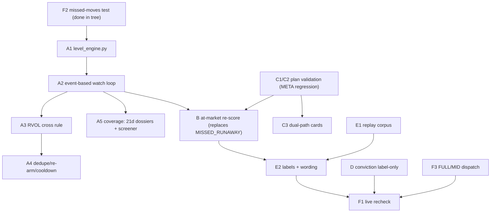

# No Lost Movers Plan

**Principle:** STALK is not a decision. It means "these levels are armed". If price crosses any armed level, or runs away from the zone, the system must re-score the name at the live price and tell you with an actionable alert. A good setup is never lost because its label said STALK.

**Alert contract (unchanged):** `BUY 100 at market-$X | stop | T1 | R:R at market` with a MEASURED or UNMEASURED tag. No sizing, no portfolio risk.

---

## What is actually broken (code, not only META)

### 1. The watch state machine is a top-down elif chain — mid-day breakouts are invisible and runners die exactly when they work

`run_watch_alerts.py:284-673` (`evaluate_watch_cycle`) evaluates one status per poll with `elif` priority (`:421-615`):

| Line | Bug |
|---|---|
| `:405-412` | `hit_breakout` only becomes true `if is_after_close` (`:370`). A mid-day breakout is invisible until 16:00 ET — the one moment most breakouts matter. |
| `:446-479` | `hit_t2` runs **before** the zone check. A name that reaches T2 without a zone fill becomes `MISSED_RUNAWAY` — *"Stock ran away from stalking zone"* (`:478`) — terminal in `update_target_live_state` (`watch_manager.py:1101-1109`). The idea is over. |
| `:481-513` | Same for `hit_t1`: first branch, so a name that works is declared dead before the breakout branch (`:438`) is even reached. |
| `:587-615` | Everything else funnels to `STALKING`/`EXPIRED`. There is no "price crossed an armed level" event concept at all. |

**This is the general bug:** any strong stock that runs is declared dead exactly when it is working. META is one instance, not the cause.

### 2. The META case: a plan whose targets sit at/below its own trigger is stored and then mis-evaluated

META: T1 = 742.09, T2 = 747.60, breakout_level = 747.60. T1 and T2 sit **at or below** the trigger, so:

- Even after close, `hit_breakout` (`:438`) is preempted by the T1/T2 branches (`:446`, `:481`).
- No check stops such a plan from being stored: `check_geometry` only validates breakout ordering when `entry_type == "BREAKOUT"` (`level_validation.py:74-75`); a judge plan that carries `breakout_level` as a field with a LIMIT entry is never geometrically checked on that path.
- `validate_levels` never computes R:R **at the trigger** using `breakout_stop` — `rr_at_market` (`level_validation.py:374`) is measured at spot only.

### 3. Coverage: 16-17 names armed, no volume context

- `get_active_watch_targets` (`watch_manager.py:1062-1076`) returns only rows with `status IN ('STALKING','IN_ZONE','IN_TRADE','TESTING_SUPPORT')` — that is the whole armed universe (~16-17 names).
- The watch loop polls via `quote_router.get_watchlist_quotes_batch` (`run_watch_alerts.py:307-313`), a 10s-TTL surveillance cache (`quote_router.py:140`) whose `QuoteData` (`:47-66`) carries today's `volume` but **no relative volume / 20-day average**, so no cross can require volume confirmation.

### 4. Conviction: an unmeasured LLM number on a mixed scale

- The card's conviction is LLM self-report; `cap_conviction` (`alert_evaluator.py:93-113`) can only pull it down. It flipped 8 and 6 on the same name across sessions.
- Two scales collided on the desk: `alerts.score` is a 0-100 card score, decision badges carry "(4/10)" band text. Partially fixed in the working tree (`desk.py:27-49` `_normalized_local_score`, `alert_evaluator.py:489-547`, `tests/test_desk_routes.py:498-510`, `tests/test_alert_evaluator.py:166-186`).
- Conviction still **ranks**: `watch_manager.py:1072` `ORDER BY date DESC, conviction DESC`; `action_engine.py:140` `high_conv`; copilot rank-by-conviction instructions (`copilot_context.py:2448`, `:2604-2605`).

---

## A. Universal level engine (every watched name, every level)

### A1. New module `src/tracking/level_engine.py`

From a stored plan, derive **one ordered list of armed levels**:

| Level | Kind | Direction (LONG) | Re-arm rule |
|---|---|---|---|
| entry zone low | `ZONE_LOW` | support (cross up = bounce) | re-arm after a close back below |
| entry zone high | `ZONE_TOP` | breakout (cross up = zone fill gone / running) | re-arm after close back inside zone |
| breakout level | `BREAKOUT` | trigger | re-arm after close back below trigger |
| prior 20-day high | `HIGH_20D` | trigger (from daily bars via `execution_validator.get_bars_since_date`, the same helper `_compute_atr14_from_bars` uses at `level_validation.py:192-204`) | re-arm after close back below |
| target 1 | `T1` | resistance | re-arm after close back below |
| target 2 | `T2` | resistance | re-arm after close back below |
| tactical stop | `STOP` | invalidation | single-fire per day |
| invalidation price | `INVALIDATION` | thesis death (daily-close rule) | single-fire per day |

Each level entry: `{kind, price, side, direction, armed, last_fired_date, last_fired_at}`. Prior 20-day high comes from the live Data Window when present, else daily bars, else omitted (absent, never fabricated).

### A2. `run_watch_alerts.py` — stop the elif-chain priority

Replace the single-status `elif` cascade (`:421-615`) with two phases:

1. **Record events:** for each armed level, detect `crossed since last poll` (previous poll price → current price, intraday). Store every crossing event for this poll.
2. **Evaluate all events** (no priority suppression): invalidate the thesis, fire target events, fire the breakout/20d-high trigger, run the B re-score — a name that reached T1 without a fill no longer ends the idea.

The existing fill-verification call (`evaluate_setup_lifecycle`, `:455`, `:490`) stays as the source of truth for "did the zone fill".

### A3. Cross rule — intraday with volume pace

A level is *crossed* when price trades through it intraday **and** volume pace ≥ 1.0× the 20-day average:

- `RVOL = quote.volume / ADV20`, where `quote.volume` is the intraday print from the surveillance quote (`quote_router.py:56`) and ADV20 is the 20-day mean daily volume (same computation as `schwab_pre_move_scan.py:612` `vols.rolling(20).mean()`, via `get_bars_since_date`).
- Daily-close confirmation becomes a **second message** ("held at close"), not a precondition (`:405-412` is deleted as a gate).
- No ADV20 available → the cross still arms as `UNMEASURED` volume (tagged), never silently dropped.

### A4. De-duplication

- One alert per (ticker, level, day): check `watch_alerts` before logging (pattern at `:528-538`).
- Re-arm only after a **close back through** the level (A1 table).
- N-minute cooldown between same-level alerts to prevent flicker (config `LEVEL_ALERT_COOLDOWN_MIN`, default 15).

### A5. Coverage — arm everything, not 16 names

Armed universe for the watch loop = union of:

1. Active `watch_targets` (existing, `get_active_watch_targets`).
2. **Every name with a dossier in the last 21 sessions** (discovery logic already exists in `rescore_recent_dossiers`, `continuous_screener_daemon.py:697-757`, and `get_missed_moves`, `missed_moves.py:96-107` — generalize from 10 to 21 sessions).
3. **Every pre-move screener candidate** (`survivors.json` / `schwab_survivors.json` manifests).

Placeholder rows stay excluded: reuse `placeholder_rows_sql()` / `is_placeholder_row()` (`watch_manager.py:1454-1482`). Armed-but-unstored names carry their dossier levels (from `*_thesis.json` long_plan) into the level engine without requiring a `watch_targets` row.

---

## B. Replace `MISSED_RUNAWAY` with a re-score at market

### B1. Re-score trigger

On **any** level cross, or whenever price is above the zone top and below T1, run the at-market R:R check at the live price using the live Data Window or the last good one. Math reuses `zone_arrival_evaluator` (`:134-141` live_rr) and the gate `is_actionable` / `gate_inputs_from_datawindow` (`actionable_gate.py`, called at `:218-240`).

### B2. Outcomes — each with a distinct alert

| Outcome | Condition | Alert |
|---|---|---|
| `RUNNING_ACTIONABLE` | gate passes, R:R at market ≥ floor, stop is a real level below price | `BUY 100 {T} at market-${X} \| stop ${S} \| T1 ${T1} \| R:R {n}@mkt` (same wording as the in-zone push at `:574`) |
| `RUNNING_NO_ROOM` | price above the plan, R:R at market under floor | `ran, no room, wait for pullback to $zone or a new level` — **stays armed** |
| `TARGET_HIT_NO_FILL` | T1 reached without fill | informational only; name returns to B1 with **refreshed levels** (recompute stop from structure — `process_survivor` stop logic — target from resistance or measured move) |

### B3. `MISSED_RUNAWAY` stops being a terminal status

A name that completed T1 without a fill is **re-queued for local triage on the live bar** so levels refresh, and a fresh plan is stored: `queue_for_research(..., force=True)` (pattern at `continuous_screener_daemon.py:889-914`) + dispatch into a free research slot. Remove `MISSED_RUNAWAY` from the terminal list in `watch_manager.py:1101-1109` and from the STAND_ASIDE verdict mapping (`run_watch_alerts.py:623`).

### B4. Labels — MEASURED only for the measured lane

- `MEASURED` only when the in-zone PB R:R gate lane applies (`is_actionable` pass on the in-zone PB path).
- A breakout or runaway buy is `UNMEASURED` and **forward-logged as its own rule** in `forward_log.py` (`UNMEASURED_RULES`, `:25-44`, ship date frozen at ship).

---

## C. Validate every stored plan (the META case)

### C1. `src/logic/level_validation.py` — breakout geometry for every plan that carries a trigger

Add to `validate_levels` (and expose as `check_breakout_geometry(...)`):

- Applies to **any** plan with `breakout_level > 0` (not only `entry_type == "BREAKOUT"` — that gate at `:74-75` is why META slipped through).
- Require `target_1 >= breakout_level` (targets above the trigger) and R:R **at the trigger** `= (t1 - breakout_level) / (breakout_level - breakout_stop)` ≥ floor.
- On failure: **demote the breakout to no-room and strip the trigger** (`breakout_level = 0`, reason recorded) instead of a hard reject, so the limit-zone path survives.

### C2. `src/logic/deep_research/arbitration.py`

- Apply C1 to the parsed judge output immediately after `validate_levels` (`:406`) and before `upsert_watch_target` (`:547`); the demoted plan must persist without a broken trigger.
- Prompt: `_build_judge_sys_prompt` (`:60-162`) must state targets must be above the trigger for LONG breakouts (add to the `shares_plan` spec `:80-90`).
- **Regression test with the META numbers** (T1 742.09, trigger 747.60, breakout_stop from the META plan) that must fail C1 and strip the trigger.

### C3. Card text — both paths, both R:R

Desk card assembly (`desk.py:357-474`): a name with a limit zone below market **and** a live breakout path states both paths and their R:R (zone R:R at entry_high; breakout R:R at the trigger), instead of one blended number.

---

## D. Conviction becomes a label

### D1. Order of information on every surface

Cards, alerts and the copilot show, in order: **gate result → R:R at market → lane → MEASURED/UNMEASURED**. Conviction is only a trailing label (capped or unmeasured). Never rank or alert on it:

- `watch_manager.py:1072` — drop `conviction DESC` from the ORDER BY (order by `date DESC`, then distance/status).
- `action_engine.py:140` (`high_conv` filter) and `:160-161` (`high_conviction` count) — display only; no gate, no signal.
- `copilot_context.py:2448`, `:2604-2605` — rank/summarise by gate / in-zone / R:R / distance; conviction moves to last in the row template (`:2058`).
- Action engine and every other service surface render the MEASURED/UNMEASURED tag and the gate result; unmeasured rows are **labelled, not hidden**; no single "test" label or regime cutoff replaces the measured gate.

### D2. One scale, no fabricated defaults

- The `75` fallback is replaced by **"unmeasured"** (done in the working tree: `alert_evaluator.py:489-547`, pinned by `tests/test_alert_evaluator.py:166-186`).
- `_normalized_local_score` (`desk.py:27-49`): a raw 0-100 value of 10 or under is **not** read as a 1-10 band — a raw "7" is a card score of 7 → 0.7 (done, pinned at `tests/test_desk_routes.py:498-510`).
- Apply `cap_conviction` on **every write path**: arbitration (`:402-404`, done) + triage write path (`process_survivor.py`, conviction comment at `:67`) + `watch_manager.upsert_watch_target` (defence in depth) so no surface can store an uncapped LLM number.

---

## E. Measurement before any "good" claim

### E1. Corpus replay — frozen honest-replay contract

Reuse the frozen contract: `evaluate_setup_lifecycle_bars` (`execution_validator.py:136` — next-open entry, stop-first same-bar resolution `:436`/`:518`, 21-bar walk `:541`, costs as in `suggestion_scorer.py`). Corpus ends **2026-08-21** (in-sample; the forward log decides out-of-sample). Replay the three new rules:

- **(a)** buy at market when price breaks above zone top without a fill;
- **(b)** buy a 20-day-high break on volume pace (RVOL ≥ 1.0);
- **(c)** buy after T1 reached without fill, with a refreshed stop.

Report per rule: era split, first/second halves, ticker breadth, median R, and fire-rate (**must stay under 6% of bars**). Lands in a new `scripts/research/replay_runaway_rules.py` with fixtures under `data/replay/`.

### E2. Output decides the label

- A rule that passes gets to say `actionable`; a rule that fails is `watch`-only wording (`RUNNING_NO_ROOM` style).
- Each alert's MEASURED/UNMEASURED tag is decided by E1's output, recorded in `forward_log.py` with a frozen ship date, not by assertion.

---

## F. Carry-overs from the Oct 12 verification

| ID | Item | State |
|---|---|---|
| F1 | Restart the server on the latest commit; recheck one conviction scale everywhere and that R:R-at-market source is only `signal` or `live` (logic at `desk.py:379-404` already excludes plan-geometry fallbacks) | verify live |
| F2 | Fix `test_missed_moves_live_scan` without backfill | **done in tree** (`tests/test_catch_movers.py:308-340`, self-contained VST fixture, green) |
| F3 | `continuous_screener_daemon.py`: `dispatch_candidate_research` (`:659-695`) hardcodes `tier="MID"` (`:667`) — send the **top-ranked** names (already sorted at `:1017-1024`) to FULL deep research and the rest to MID | todo |

---

## Sequencing

## Verification

**Unit**
- A plan whose T1 is reached without a fill produces `RUNNING_ACTIONABLE` or `RUNNING_NO_ROOM`, **never** a terminal status.
- A mid-day cross of any level fires exactly one alert.
- The META-number plan (T1 742.09, trigger 747.60) fails C1 and has its trigger stripped.
- All level kinds (zone high, breakout, 20-day high, T1, T2) have a cross test, long side.

**Replay fixtures** — each must produce an alert at the cross time with a stated R:R at market:
- META 10-09 (718.67) → 10-12 (748.10)
- VST 140.44 → 166.66
- NRG 102.75 → 109.22

**Live**
- `/api/desk/today` has no mixed scales (one conviction scale; `rr_at_market_source` only `signal`/`live`).
- Missed-move rows show the reason **plus** alert-sent.
- `pytest` fully green on Python 3.10 and 3.12.

## Out of scope

Position sizing, portfolio risk, short side, Pine changes, and any new conviction threshold.
