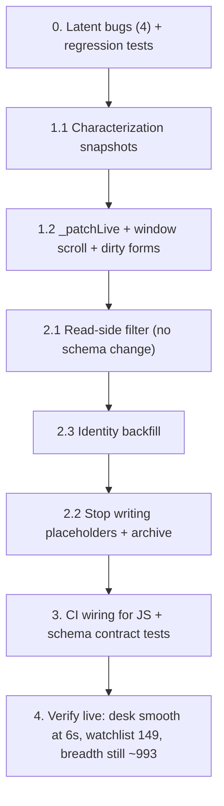

# Desk render + watchlist refactor

**Investigation basis:** three parallel agents mapped `loadToday` (desk.js:827-1777), the `watch_targets` data layer (49 columns / 993 rows / 20 writers / 24 readers), and the test infrastructure (1173 pytest + 6 JS suites, JS absent from CI). This plan is built on their findings, not guesses.

---

## 0. Latent bugs found during investigation — ship these first, independently

These are small, provable, and block the refactor. Each has file:line evidence from the audit.

### 0.1 `position_state.py` writes to columns that don't exist → **this is the 22% exit-capture mystery**

`src/tracking/position_state.py:397-405` runs:
```sql
UPDATE watch_targets SET status='COMPLETED', exit_price=?, r_realized=? WHERE ticker=?
```
`watch_targets` has **no `exit_price` and no `r_realized` column**. The `sqlite3.OperationalError` is swallowed at `:407-408`. So every position closed by the tracker fails to record its outcome in the watchlist, silently, forever.

Evidence this is the capture hole: `watch_targets.entry_zone_*` is populated on 64/993 rows and `last_price` on 148 — the same population the paper evaluator relies on. The calibration panel's "only 22% of closed trades recorded an exit price" is not a data-entry failure by the close paths; it is this UPDATE throwing.

**Fix:** write to the real schema — `status`, `last_price`, `evaluation_verdict`, `updated_at` — and add the missing columns to the thesis/ledger path instead. Then a test: close a position via `close_position()` and assert the watchlist row changed.

### 0.2 `AppDesk.triggerResearch` does not exist

`web/static/js/desk.js:1591` — the coverage tab's "Run Research" button calls `AppDesk.triggerResearch(item.ticker)`. No such method. It throws a TypeError on every click. The real API is `AppApi.triggerResearch` (`web/static/js/api.js:306`).

It is invisible to `tests/ui_wiring_audit.py:18` because that audit only scrapes `index.html` onclicks, and every desk handler is generated inside JS. **Extend the audit to also scrape `onclick="Foo.bar("` out of the JS source itself** — that is how it stays broken.

### 0.3 Scroll preservation is a no-op

`desk.js:1760` reads `#today-content-container.scrollTop`. That element has an empty inline style (`web/index.html:155`) and **no CSS `overflow` rule anywhere** (`web/static/css/*.css` has zero matches). The window is the scroller, so `cont.scrollTop` is always `0` and `if (prevScroll > 0)` is never true.

`tests/desk_rerender_guard.test.js:78-84` only string-matches the statements, so it passes while doing nothing. **Fix to preserve `window.scrollY`**, and replace the substring assertions with behaviour (see §1).

### 0.4 The self-healing placeholder guard

`src/ui/routes/watchlist.py:82-88` — `if len(rows) < 500: ensure_universe_prepopulated()` re-creates all 844 placeholder rows. Any prune is undone on the next `GET /api/watch-targets`. This is the single migration blocker and must be handled **before** any deletion.

---

## 1. Today desk render (`web/static/js/desk.js`)

**Current:** `loadToday` fires 6 requests, builds one ~900-line HTML string, and does `cont.innerHTML = html` at `desk.js:1762`. Driven by a 6s interval (`app.js:162-175`) plus 9 controller reloads.

**Audit verdict:** only **three** areas actually change per poll. Sections 5-9 (opp cards, alerts table, positions/feedback forms, coverage, missed moves) are already gated behind sub-tabs and are only rebuilt when a controller deliberately reloads.

### 1.1 Characterize first (P1-P4, before touching the renderer)

| Test | File | Asserts |
|---|---|---|
| **Snapshot** | `tests/desk_loadtoday_characterization.test.js` | For ~10 fixtures (happy path + hostile), `loadToday` writes **byte-identical** HTML into `#today-content-container` vs committed snapshots. Copy the real stub-DOM harness from `tests/rev_chat_focus.test.js:51-75` (the only working one in the repo). |
| **Re-render behaviour** | `tests/desk_loadtoday_rerender.test.js` | Second `loadToday` with unchanged payload: scrollTop stays, focus restored to the focused `<input>` **after** the swap, and the movers/ledger subtree renderer runs exactly once (spy). Replaces the substring assertions at `desk_rerender_guard.test.js:78-91`. |
| **Poll wiring** | `tests/app_poll_loop_guard.test.js` | Exactly one 6s interval calls `loadToday(true)`, guarded on `currentDesk === 'today'`; `silent=true` early-returns when `document.activeElement` is INPUT/TEXTAREA (`desk.js:828-830`). Currently unpinned. |
| **Field coverage** | `tests/desk_render_field_coverage.test.js` | Every field the render consumes (`pulse.spy`, `market_regime.fear_greed.score`, `top_opportunities[].ticker`, `action_panel.bat_signal.counts`, …) has a sentinel from the fixture appearing in the output. **This is the test that catches a dropped column during the rewrite** — today's biggest hole: nothing links payload → HTML. |

Snapshot rule: capture in the same harness `_lastTodayData` identity, the exact `memoRender` keys touched, renderer invocation counts, and the number of `cont.innerHTML =` writes across two calls.

### 1.2 The refactor itself

Keep the fetch plumbing, the payload assembly and the error path. Replace only the commit:

- **Keep `_renderFull()`** — today's `1754-1768` verbatim, for sub-tab switches, filter changes, and every controller reload (`desk.js:23, 707, 712, 741, 742, 774`). This also keeps `desk_rerender_guard.test.js`'s source contract satisfiable.
- **Add `_patchLive()`** — the per-poll path, touching only:
  - the market-status pill and SPY/QQQ/VIX strip (write into stable spans),
  - the regime strip and bat signal (write into two **stable** divs `#desk-regime-strip` / `#desk-bat-signal`, skipping the write when `memoRender` returns the cached string — this preserves the memo contract at `desk.js:38-45` while removing the re-parse),
  - funnel counts and the 6 sub-tab count badges (text nodes / active class only).
- **Window scroll preservation** (`window.scrollY`), restored **after** any `focus()` call — `focus()` scrolls into view and currently overrides the restore.
- **In-flight guard** on `_isPollingToday` (`desk.js:703`, declared and never used) so a poll never commits over a controller reload. With one swap that was a whole-desk rollback; with partial updates it becomes a partial rollback, which is worse.
- **Dirty-form protection:** a `_dirtyFeedbackIds` set fed by `input`/`change` listeners on `#fb-grade-*` / `#fb-notes-*` / `#fb-lesson-*`. Typed notes are currently destroyed ~6s after blur; the `silent` guard at `828-830` covers only INPUT/TEXTAREA, never SELECT, and never the non-silent paths. **This is the one behavior change that is a genuine fix.**
- **Drop the dead `recordData` fetch** at `desk.js:834` — fetched every 6s, never read.
- **Fix 0.2's `triggerResearch`** while the coverage table is open.

### 1.3 Explicitly out of scope
The orphaned helpers (`rrGateControl:549-605`, `renderInboxTable:419-474`, `setTastytradeAlert:394-417`, briefing `368-392`, the `#briefing-t2-*` toggle) and the `tv_hover.js:399` detached-target stickiness. Separate cleanup; do not mix.

---

## 2. `watch_targets` (`src/tracking/watch_manager.py`)

**Audit conclusion: a 4-table split is NOT justified.** Three of the four jobs already have homes — `watch_alerts` (9,682 rows) is the alert log, `suggestions` (449) + `suggested_trades_audit` (149) are the trade ledger, `thesis_paper_trades` (64) is attribution. The only genuine defect is `ensure_universe_prepopulated` using `watch_targets` as universe storage.

### 2.1 Read-side filter first (~10 lines, 4 files, zero schema change)

| File:line | Change |
|---|---|
| `src/ui/routes/watchlist.py:81` | add `AND status != 'UNRESEARCHED'` (plus disable the `<500` guard at `:82`) |
| `src/ui/services/copilot_context.py:2151-2156` | add `WHERE status NOT IN ('UNRESEARCHED')` — this query is **unfiltered** and dumps 844 null-level rows into the LLM prompt today |
| `src/ui/services/opportunity_service.py:750` | point `_tracked_universe()` at the constituents CSV (`watch_manager.py:1293`) so the breadth denominator stays ~993 symbols instead of collapsing to 149 |
| `src/ui/routes/status.py:317` | repoint `/api/tickers` to the same source |

Effect: UI watchlist 993 → 149, LLM context stops listing 844 empty rows, breadth/movers unchanged in meaning.

### 2.2 Then stop writing placeholders

`watch_manager.py:1386-1398` — the placeholder loop, guarded by §0.4's guard being disabled first. Archive, don't delete:

```sql
VACUUM INTO 'data/research_watch_pre_split.db';
CREATE TABLE watch_targets_backup_placeholders AS SELECT * FROM watch_targets WHERE status='UNRESEARCHED';  -- 844
DELETE FROM watch_targets WHERE status='UNRESEARCHED';                                                     -- 993 -> 149
CREATE TABLE tracked_universe (ticker TEXT PRIMARY KEY, name TEXT, source TEXT DEFAULT 'schwab1000', added_at TEXT);
INSERT INTO tracked_universe (ticker, name, source, added_at)
  SELECT ticker, REPLACE(COALESCE(options_summary,''),'Schwab 1000 (',''), 'schwab1000', updated_at
  FROM watch_targets_backup_placeholders;
CREATE VIEW v_watch_targets_all AS SELECT w.* FROM watch_targets w
  UNION ALL SELECT b.* FROM watch_targets_backup_placeholders b;
```
Rollback: `INSERT OR REPLACE INTO watch_targets SELECT * FROM watch_targets_backup_placeholders;`

### 2.3 Identity backfill (makes paper seeding idempotent)

`thesis_id`, `created_date`, `expires_on` are **0% populated** on all 993 rows. `thesis_evaluator.backfill_paper_trades` synthesizes `f"{ticker}_{created_date}"` from `date`, so every re-run must reproduce that formula or it duplicates instead of upserting:

```sql
UPDATE watch_targets
SET created_date = COALESCE(NULLIF(created_date,''), date),
    thesis_id   = COALESCE(NULLIF(thesis_id,''), ticker || '_' || COALESCE(NULLIF(created_date,''), date))
WHERE thesis_id IS NULL OR thesis_id = '';
```
Also `tests/test_suite_hygiene.py:229-251` forbids inline `data/` paths — any new module must resolve via `config.research_watch_db_path()`.

---

## 3. Test infrastructure

### 3.1 Ship with this work
| Test | File | Why it matters |
|---|---|---|
| **Schema contract** | `tests/test_watch_targets_schema_contract.py` | Pins the ~45-column set from `PRAGMA table_info`; asserts fresh-create and migrate-up produce **identical** schemas. The 16-branch migration ladder at `watch_manager.py:82-128` is currently untested — this is what makes it safe to refactor. Parametrise: drop each column, re-run `init_watch_db()`, assert it returns. |
| **Upsert semantics** | `tests/test_watch_targets_upsert_semantics.py` | Pins the open-thesis preservation rule (`watch_manager.py:462-473`), geometry rejection → `rejected_plans` (`:421-432`), 5-trading-day expiry, the `{ticker}_{date}` id formula. |
| **Funnel writer** | `tests/test_sync_active_suggestions_to_watch_targets.py` | `sync_active_suggestions_to_watch_targets` (`:876+`) has **zero** tests. Mixed `gate_status`, out-of-lookback dates, duplicate tickers, null side/stop/target. Same for the orphan `backfill_watch_targets_gate_inputs`. |
| **Real-schema desk fixtures** | extend `tests/test_desk_routes.py` (`:79-87` seeds a 5-6 column stub) and `tests/test_rr_presets_and_recalc.py` (`:161-166`, 12 columns) to call `watch_manager.init_watch_db()`. **A dropped column passes every desk test today because the stub never had it.** |
| **Position-close write** | `tests/test_position_state_watchlist_write.py` | Regression test for §0.1. |
| **JS audit on generated handlers** | extend `tests/ui_wiring_audit.py:18` | Scrape `onclick=` out of the JS sources too — this is how §0.2 stayed broken. |

### 3.2 CI gap
`.github/workflows/ci.yml` runs only `ruff check`, `ruff format --check`, `pytest`. **The six JS suites (75 assertions, ~0.4s) are not in CI and nothing invokes them.** Add a step:
```yaml
- run: for f in tests/*.test.js; do node "$f" || exit 1; done
```
Without this they rot until they're worse than no test.

### 3.3 Constraints the suite enforces (don't fight them)
- `tests/conftest.py:44-54` redirects every DB into tmp **before collection** (several modules bind `DB_PATH` at import), plus a session-scoped schema template copied per test (`:118-124`).
- `tests/test_db_isolation_invariant.py:27-61` and `test_suite_hygiene.py:229-251` forbid inline `data/` paths, `time.sleep`, wall-clock asserts, and bare module-attribute monkeypatching. New tests must use `monkeypatch`/`tmp_path`.
- No `RUN_LIVE_E2E` (10 tests in `test_ui_api_core.py` stay skipped) and no network — stub Schwab/Yahoo/CNN the way `test_watch_alerts.py:19-23` and `test_copilot_chat.py:28-42` do.

---

## 4. Sequencing



## 5. Verification (what I run after each phase)

```powershell
# always
ruff check . ; ruff format --check .
python -m pytest tests/test_watch_alerts.py tests/test_desk_routes.py tests/test_rr_presets_and_recalc.py tests/test_position_state.py -q
node tests/rev_chat_focus.test.js; node tests/desk_render_guard.test.js; node tests/desk_rerender_guard.test.js; node tests/chat_context_guard.test.js
# full
python -m pytest -q          # ~5-10 min, 1173 tests
python tests/ui_wiring_audit.py
# live
Invoke-WebRequest http://127.0.0.1:8050/api/desk/today   # action_panel intact, breadth ~= 993
Invoke-WebRequest http://127.0.0.1:8050/api/watch-targets # targets 149, placeholders gone
```

Then in the browser: sit on the Today desk for 30s — movers/bat-signal update, cards stop re-creating, scroll does not jump, and typing a feedback note survives a poll.

## 6. What this is worth

- **Desk:** one 6s DOM rebuild of ~900 lines becomes three text writes. Section subtrees stop re-parsing, hover/scroll/focus survive, and the feedback form stops eating typed notes.
- **Watchlist:** 993 rows → 149 real ones, the LLM prompt stops listing 844 empty placeholders, and the paper metric's idempotency is fixed.
- **The pay-off:** §0.1 means position closes have been failing to write back the whole time. That, not "users don't fill in exit prices", is why only 22% of closed trades had an outcome — and it is the prerequisite for the calibration data being trustworthy at all.
